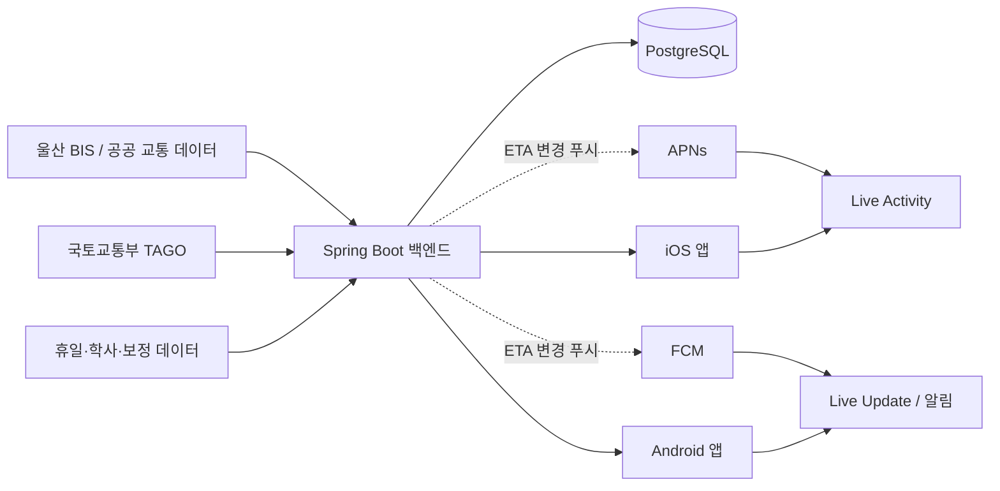

# UNIST Bus 앱 — 로컬 Codex 프로젝트 인수인계서

> 마지막 정리: 2026-07-22
> 작업 환경: Apple Silicon M5 Pro MacBook Pro, 48GB RAM
> 목적: 이 문서 하나만 읽고도 로컬 Codex가 프로젝트를 점검하고 첫 번째 동작 가능한 버전을 구현할 수 있게 한다.

## 1. 프로젝트 한 줄 설명

UNIST 구성원이 자주 이용하는 버스의 도착 정보를 네이티브 iOS·Android 앱에서 확인하고, 사용자가 선택한 특정 버스의 남은 시간을 잠금화면에서 실시간으로 보여주는 서비스다.

Bus HeXA 웹사이트는 문제와 사용 흐름을 이해하기 위한 레퍼런스일 뿐이다. 해당 서비스의 디자인·코드·비공개 API를 복제하거나 의존하지 않고, 독립적인 앱과 백엔드를 만든다.

### 확정한 제품 확장 순서

1. **UNIST 전용:** 학생·교직원을 대상으로 핵심 정류장 3곳과 교내 운행 5개 노선의 실제 도착 정보 및 잠금화면 추적을 완성한다.
2. **울산 전역:** UNIST 버전이 안정된 뒤 정류장·노선 검색과 즐겨찾기를 추가한다.
3. **국내 전체:** 지역별 공식 데이터 공급자를 adapter로 추가하고 지역 선택을 제공한다.

현재 디자인은 v0.1로 동결한다. 기능 구현 중 확인되는 명확한 버그, 가독성, 접근성 문제만 수정하고 새로운 디자인 실험은 실제 데이터·캐시·원격 갱신이 안정된 뒤 진행한다. 사용자 화면은 UNIST에 최적화하되 내부 식별자는 데이터 공급자·지역·정류장·노선을 구분해 확장 시 핵심 계약을 다시 만들지 않는다.

## 2. 가장 중요한 사용자 경험

1. 사용자가 정류장 또는 즐겨찾기에서 탈 버스를 고른다.
2. 앱이 현재 예상 도착 시각과 데이터 갱신 상태를 보여준다.
3. 사용자가 `잠금화면에서 보기`를 누른다.
4. 앱을 닫거나 휴대폰을 잠가도 남은 시간이 표시된다.
5. 도착 예상 시각이 바뀌거나 운행이 취소되면 표시도 갱신된다.
6. 버스가 도착했거나 추적 시간이 만료되면 잠금화면 표시가 종료된다.

핵심 성공 기준은 “앱을 계속 열어두지 않아도 내가 탈 버스가 몇 분 남았는지 신뢰할 수 있게 알 수 있다”이다.

## 3. 확정한 기술 결정

| 영역 | 결정 |
|---|---|
| iOS | Swift, SwiftUI, ActivityKit, WidgetKit, 최소 iOS 17 |
| Android | Kotlin, Jetpack Compose, Material 3, 최소 API 26 |
| Android 잠금화면 | Android 16 QPR 계열/API 36.1+ Live Updates 우선, 이전 버전은 ongoing notification + chronometer |
| 백엔드 | Kotlin, Spring Boot 4.1.x, Java 21 LTS, Gradle Kotlin DSL 및 Wrapper |
| API | REST + OpenAPI 3.x, JSON, `/api/v1` 버저닝 |
| DB | PostgreSQL 18 계열, Flyway, jOOQ |
| 로컬 인프라 | Docker Desktop + Docker Compose |
| 푸시 | APNs와 FCM. 첫 수직 기능 구현 후 도입 |
| 구조 | 하나의 저장소, 모듈형 모놀리스 백엔드 |
| 공유 코드 | 초기에는 KMP 미사용. 계약·규칙·테스트 fixture·디자인 토큰만 공유 |

### 의도적으로 초기 도입하지 않는 것

- Compose Multiplatform UI 또는 공유 UI
- Kotlin Multiplatform 공통 비즈니스 계층
- 마이크로서비스, Kafka, GraphQL, WebSocket
- 매분 푸시하는 방식
- iOS/Android에서 공공데이터 API를 직접 호출하는 방식
- 실제 키나 비밀값을 저장소에 넣는 방식

네이티브 잠금화면 경험이 제품의 중심이므로 UI와 플랫폼 생명주기는 각각 Swift/SwiftUI와 Kotlin/Compose로 구현한다. 중복이 실제 유지보수 문제로 확인되기 전에는 KMP를 추가하지 않는다.

## 4. 전체 구조



백엔드는 외부 데이터 소스를 수집·정규화·캐시하고 앱에는 안정적인 자체 API만 제공한다. 앱은 서버가 내려준 절대 시각을 기준으로 남은 시간을 로컬에서 계산한다.

## 5. 데이터 출처에 관한 현재 판단

선행 분석상 Bus HeXA는 울산 버스정보시스템, 국토교통부 TAGO 계열 공공 API, 휴일/달력 데이터 등을 자체 백엔드에서 결합했을 가능성이 높다. 그러나 이는 우리 앱이 해당 서비스의 내부 API를 사용해도 된다는 뜻이 아니다.

구현 원칙:

- 울산시·공공데이터포털 등 원 제공처에서 우리 프로젝트 명의로 사용 가능한 API와 라이선스를 확인한다.
- 키는 백엔드 환경변수나 운영 비밀 저장소에만 둔다.
- 모바일 앱, Git 기록, 샘플 파일에는 키를 절대 넣지 않는다.
- Bus HeXA의 비공개 엔드포인트를 역공학하거나 크롤링하지 않는다.
- 외부 데이터 약관, 재배포 범위, 호출 제한, 출처 표시 의무를 연동 전에 기록한다.
- 데이터 출처가 확정되기 전에는 deterministic fixture로 기능을 개발한다.

### 초기 핵심 정류장

| 정류장 ID | 공식 표시명 | 역할 |
|---|---|---|
| `40234` | 울산과학기술원 | 교내 통과 정류장 |
| `40233` | 울산과학기술원(기점) | 기점 |
| `40235` | 울산과학기술원(종점) | 종점 |

모바일 앱은 세 ID를 서로 다른 API 식별자로 유지하되, 첫 화면에서는 모두 동시에 조회해 하나의 도착 목록으로 합친다. 사용자가 정류장을 고르게 하지 않으며, 같은 노선이 여러 정류장 응답에 있으면 가장 이른 도착 한 건을 보여준다. `40233`과 `40235`는 기점·종점 쌍이지만 데이터 계층에서는 하나의 ID로 합치지 않는다.

현재 [UNIST 공식 오시는 길](https://www.unist.ac.kr/unist/introduction/location.do)이 안내하는 교내 운행 노선은 `513`, `713`, `743`, `753`, `1115`의 다섯 개다. fixture와 첫 화면은 이 다섯 노선을 모두 포함한다.

## 6. 권장 저장소 구조

```text
unist-bus/
├── ios/
│   ├── UNISTBus/
│   ├── UNISTBusLiveActivity/
│   └── UNISTBusTests/
├── android/
│   ├── app/
│   └── gradle/
├── backend/
│   ├── src/main/kotlin/
│   ├── src/main/resources/
│   ├── src/test/kotlin/
│   ├── build.gradle.kts
│   ├── settings.gradle.kts
│   └── gradlew
├── contracts/
│   └── openapi.yaml
├── docs/
│   ├── architecture.md
│   └── data-sources.md
├── compose.yaml
├── .env.example
├── .gitignore
└── README.md
```

백엔드는 전역 `controller/service/repository` 폴더보다 기능 중심으로 나눈다.

```text
backend/src/main/kotlin/.../
├── arrival/
├── route/
├── stop/
├── collector/
├── push/
└── config/
```

## 7. 시간 모델 — 반드시 지킬 계약

서버는 `7분 남음` 같은 상대 문자열을 핵심 데이터로 보내지 않고 절대 시각과 상태를 보낸다.

```json
{
  "tripId": "fixture-trip-001",
  "routeId": "fixture-route-513",
  "routeName": "513",
  "stopId": "40234",
  "stopName": "울산과학기술원",
  "scheduledArrivalAt": "2026-07-22T09:20:00+09:00",
  "estimatedArrivalAt": "2026-07-22T09:17:00+09:00",
  "observedAt": "2026-07-22T09:07:00+09:00",
  "staleAt": "2026-07-22T09:09:00+09:00",
  "status": "APPROACHING"
}
```

권장 상태값:

```text
SCHEDULED | APPROACHING | ARRIVING | ARRIVED | DELAYED | CANCELLED | UNKNOWN
```

클라이언트는 `estimatedArrivalAt - 현재 기기 시각`으로 표시를 계산한다.

- iOS: SwiftUI 타이머 표현과 ActivityKit의 시스템 시간 표현을 활용한다.
- Android: notification `setWhen(eta)` 및 countdown chronometer를 활용한다.
- `staleAt`이 지나면 정확한 분 숫자를 계속 믿게 하지 말고 `정보 갱신 중` 또는 `데이터 지연`을 표시한다.
- 앱과 위젯이 같은 날짜 파싱, 시간대, 반올림, 상태 규칙을 사용해야 한다.
- 서버와 단말 시간 오차를 고려할 수 있도록 응답 헤더 `Date` 또는 `serverTime` 도입을 검토한다.

## 8. API 초안

첫 수직 기능에 필요한 최소 엔드포인트:

```http
GET /api/v1/stops/{stopId}/arrivals
```

예시 응답:

```json
{
  "stop": {
    "id": "40234",
    "name": "울산과학기술원"
  },
  "arrivals": [
    {
      "tripId": "fixture-trip-001",
      "routeId": "fixture-route-513",
      "routeName": "513",
      "destination": "덕하 차고지",
      "scheduledArrivalAt": "2026-07-22T09:20:00+09:00",
      "estimatedArrivalAt": "2026-07-22T09:17:00+09:00",
      "observedAt": "2026-07-22T09:07:00+09:00",
      "staleAt": "2026-07-22T09:09:00+09:00",
      "status": "APPROACHING"
    }
  ]
}
```

후속 엔드포인트 후보:

```http
GET    /api/v1/stops
GET    /api/v1/routes
GET    /api/v1/trips/{tripId}
POST   /api/v1/subscriptions
DELETE /api/v1/subscriptions/{subscriptionId}
POST   /api/v1/devices
```

오류 응답은 RFC 9457 Problem Details 형식 사용을 우선 검토한다. OpenAPI 문서를 계약의 단일 기준으로 삼고 두 앱의 모델 생성 또는 계약 테스트에 사용한다.

## 9. 최소 데이터 모델

첫 단계에는 아래 정도로 시작한다.

```text
stop
- id
- source
- source_stop_id
- name
- latitude
- longitude
- active

route
- id
- source
- source_route_id
- name
- direction
- active

arrival_snapshot
- id
- stop_id
- route_id
- source_trip_id
- scheduled_arrival_at
- estimated_arrival_at
- observed_at
- stale_at
- status
- raw_payload_hash

device
- id
- platform
- push_token_encrypted
- push_environment
- updated_at

tracking_subscription
- id
- device_id
- trip_key
- stop_id
- route_id
- expires_at
- state
```

외부 식별자는 공급자마다 의미가 다를 수 있으므로 내부 ID와 `source_*_id`를 분리한다. 원본 응답 전체를 무기한 보관하지 말고 장애 조사에 필요한 범위와 보존 기간을 정한다.

## 10. iOS 구현 요구사항

- SwiftUI와 Apple 기본 컴포넌트를 우선 사용한다.
- Xcode에서 iOS App 타깃과 Widget Extension을 만들고 `Include Live Activity`를 포함한다.
- App과 Widget Extension이 같은 `ActivityAttributes` 타입을 컴파일하도록 타깃 멤버십을 확인한다.
- `Info.plist`에 `NSSupportsLiveActivities = YES`를 설정한다.
- Live Activity 시작, ETA 갱신, 종료를 별도 작은 서비스로 캡슐화한다.
- 잠금화면에는 노선, 목적지/정류장, `출발/도착까지 분:초` 남은 시간, 데이터 지연 상태만 우선 표시한다.
- `ActivityAttributes`에 기점은 `departure`, 일반·종점은 `arrival`인 이벤트 종류를 명시하고 정류장명 문자열로 추론하지 않는다.
- stale 상태에서도 마지막 ETA 기준 카운트다운은 유지하되 `마지막 정보 기준`과 갱신 지연 경고를 함께 표시하며, 도착·취소 상태는 stale보다 우선한다.
- Dynamic Island가 있는 기기의 compact/minimal/expanded 표현도 시스템 제약 안에서 구현한다.
- 홈 화면 위젯은 즐겨찾기 요약용 후속 기능이다. 핵심 추적 UI는 Live Activity다.
- App Group은 앱과 위젯이 실제로 저장 데이터를 공유해야 할 때만 추가한다.
- Apple Human Interface Guidelines를 따르고 접근성 Dynamic Type, VoiceOver, 대비, 다크 모드를 검증한다.
- 최신 시스템 외형은 직접 흉내 내지 말고 SwiftUI 기본 재질과 컨트롤을 사용한다.

개발 제약:

- 무료 Personal Team으로 Simulator 및 본인 iPhone 로컬 기능 검증은 가능하지만 프로비저닝이 주기적으로 만료될 수 있다.
- TestFlight/App Store 배포와 APNs 기반 원격 Live Activity 갱신에는 유료 Apple Developer Program이 필요하다.
- 푸시 연결 전에는 앱 내 fixture로 Live Activity 시작·로컬 갱신·종료를 먼저 완성한다.

## 11. Android 구현 요구사항

- Kotlin, Jetpack Compose, Material 3를 사용한다.
- `minSdk = 26`, `compileSdk/targetSdk = 37`을 시작점으로 하되 설치 시점의 공식 안정 버전을 다시 확인한다.
- API 36.1+에서는 시스템 Live Updates/승격 알림 경로를 사용한다.
- API 26–35와 승격이 허용되지 않은 기기에서는 ongoing notification + countdown chronometer를 반드시 제공한다.
- API 33+의 `POST_NOTIFICATIONS` 런타임 권한 흐름을 구현한다.
- Live Update 관련 `POST_PROMOTED_NOTIFICATIONS` 매니페스트 요구사항은 구현 시 공식 문서의 최신 명칭·조건을 다시 확인한다.
- 제조사와 사용자 설정에 따라 승격이 보장되지 않으므로 일반 알림 자체만으로도 정보가 완결되어야 한다.
- Glance는 즐겨찾기 홈 화면 요약용 후속 기능이며, 초 단위/분 단위 잠금화면 추적의 핵심 도구로 사용하지 않는다.
- FCM은 로컬 알림 기능이 검증된 뒤 추가한다.
- Firebase 사용 시 별도 deprecated `firebase-messaging-ktx`가 아니라 메인 `firebase-messaging` 모듈을 사용한다.
- Firebase 등록 전에 최종 `applicationId`를 확정한다.
- TalkBack, 글꼴 확대, 다크 테마, 색상 대비를 확인한다.

권장 테스트 기기:

- API 37 ARM64 Google Play 이미지
- API 36.1 Live Update 지원 이미지
- API 33 알림 권한 경계
- API 26 하한선 및 fallback

## 12. 백엔드 구현 요구사항

Spring Initializr 또는 동등한 방식으로 다음 의존성을 시작점으로 사용한다.

- Spring Web
- Validation
- Actuator
- jOOQ
- PostgreSQL Driver
- Flyway
- Docker Compose Support
- Testcontainers PostgreSQL

후속 연동 시 고려:

- 외부 XML 응답이 있으면 Jackson XML
- 재시도, rate limit, circuit breaker가 필요해지면 Resilience4j
- APNs/FCM 어댑터는 `push` 기능 뒤의 인터페이스로 격리

원칙:

- Gradle은 전역 설치하지 말고 `./gradlew`를 사용한다.
- Java 21 LTS를 백엔드용으로 사용한다.
- 수집기 실패와 사용자 API 실패를 분리한다.
- 외부 API 응답은 그대로 노출하지 말고 내부 표준 모델로 정규화한다.
- 호출 제한 보호를 위해 캐시와 polling 간격을 명시한다.
- Actuator의 민감 엔드포인트를 외부에 무방비로 공개하지 않는다.
- 로그에 API 키, 푸시 토큰, 전체 개인정보를 남기지 않는다.

Docker Compose의 PostgreSQL 예시 기준은 `postgres:18.4-bookworm`이다. PostgreSQL 18 이미지는 볼륨 경로 변화가 있으므로 공식 이미지 설명에 따라 `/var/lib/postgresql`을 사용하고 실제 설치 시 다시 확인한다.

## 13. Mac 개발 환경 준비

안정판 도구를 사용한다. 2026-07-22 기준 권장 조합은 Xcode 26.6, Android Studio Quail 2, IntelliJ IDEA, Docker Desktop Apple Silicon, Temurin/OpenJDK 21이다. 로컬 설치 시 각 공식 사이트에서 안정판과 OS 요구사항을 다시 확인한다.

```bash
xcode-select --install
brew install git
brew install --cask temurin@21 android-studio docker-desktop intellij-idea
```

확인 명령:

```bash
uname -m
git --version
java -version
xcodebuild -version
docker compose version
```

기대 사항:

- `uname -m`은 `arm64`
- Android 빌드는 Android Studio의 bundled JBR 사용 가능
- 백엔드는 명시적으로 JDK 21 사용
- iOS 17을 deployment target으로 두되 최신 Xcode Simulator도 함께 시험
- Docker Desktop에서 Apple Silicon 네이티브 이미지를 우선 사용

## 14. 로컬 네트워크 주소

개발 중 백엔드가 Mac의 `8080` 포트에서 실행된다고 가정한다.

| 클라이언트 | API 주소 |
|---|---|
| iOS Simulator | `http://127.0.0.1:8080` |
| Android Emulator | `http://10.0.2.2:8080` |
| 실제 iPhone/Android 로컬 개발 | 같은 Wi-Fi의 Mac LAN IP, 예: `http://192.168.x.x:8080` |
| 친구 테스트/운영 | `https://unist-bus-api-60408467370.asia-northeast3.run.app` |

개발용 HTTP 예외는 Debug 설정으로 제한한다. 운영 앱은 HTTPS만 사용한다.
Android 친구 테스트 APK는 `build/UNISTBus-0.2.0-live-debug.apk`이며, TAGO
인증키를 포함하지 않고 위 HTTPS 백엔드에 연결한다.

## 15. 첫 번째 수직 기능

실제 BIS 연동 전에 아래 흐름을 끝까지 동작시킨다.

1. 저장소와 세 플랫폼 프로젝트를 만들고 각 Wrapper/프로젝트 설정을 커밋한다.
2. Docker Compose로 PostgreSQL을 실행한다.
3. Flyway가 `stop`, `route`, `arrival_snapshot` 테이블과 UNIST 핵심 정류장 fixture 세 개를 만든다.
4. 백엔드가 `GET /api/v1/stops/{stopId}/arrivals`를 제공한다.
5. 테스트 모드에서는 `현재 시각 + 10분`인 ETA를 반환한다.
6. iOS 앱에서 세 핵심 정류장의 다섯 노선을 한 목록으로 보여주고, 노선을 선택해 로컬 Live Activity를 시작한다.
7. Android 앱에서도 같은 통합 목록에서 노선을 선택한 후 ongoing notification을 게시한다. 지원 버전에서는 Live Update 표현도 사용한다.
8. 두 플랫폼 잠금화면에서 시간이 앱 재실행 없이 줄어드는지 확인한다.
9. fixture ETA를 변경해 UI가 갱신되고, `staleAt` 경과 및 종료 상태가 제대로 표현되는지 확인한다.
10. 이 흐름을 자동 테스트와 수동 테스트 체크리스트로 남긴다.

그 다음 순서:

1. 실제 울산 BIS/TAGO 계약과 약관 확인
2. 수집기 및 정규화 계층 구현
3. 캐시·stale 정책과 장애 대응
4. APNs/FCM 원격 갱신
5. 즐겨찾기와 홈 화면 위젯
6. TestFlight/내부 Android 테스트 배포

## 16. 푸시와 갱신 정책

매분 서버가 푸시하지 않는다. 서버는 절대 ETA를 보내고 OS가 로컬 카운트다운을 그린다.

푸시를 보낼 사건:

- ETA가 사용자에게 의미 있는 임계값 이상 변경됨
- 지연 또는 취소
- 차량/운행 식별자가 바뀜
- 추적 종료
- 데이터가 장시간 stale 상태로 전환됨

정확한 임계값은 실제 데이터 변동성을 본 뒤 정한다. 초기 fixture에서는 60초 이상 ETA 변경을 예시 기준으로 사용할 수 있다.

추적 구독에는 반드시 만료 시각을 둔다. 도착 후 또는 합리적인 최대 시간 이후 서버와 단말 양쪽에서 종료해 오래된 Live Activity/알림이 남지 않게 한다.

## 17. 품질 및 테스트 기준

백엔드:

- 날짜·시간대·stale 판정 단위 테스트
- 외부 payload → 내부 모델 매핑 테스트
- Testcontainers PostgreSQL 통합 테스트
- OpenAPI 계약 테스트
- 외부 API timeout, malformed XML/JSON, rate limit, 중복 데이터 테스트

iOS:

- API 응답 decoding 및 시간 계산 테스트
- Live Activity start/update/end 단위 경계 테스트
- 잠금화면/Dynamic Island snapshot 또는 수동 시각 검증
- 배경 전환, 재부팅, 시간대 변경, 네트워크 끊김 테스트

Android:

- API 응답 serialization 및 시간 계산 테스트
- API 레벨별 notification 분기 테스트
- 권한 거절, 승격 불가, 앱 강제종료, 재부팅 테스트
- Emulator에서 실제 알림 표시 확인

공통 수용 기준:

- 두 앱이 같은 fixture에서 같은 남은 분과 상태를 보여준다.
- ETA는 절대 시각 기준이며 화면 진입 시각에 의존하지 않는다.
- stale 데이터가 정상 데이터처럼 보이지 않는다.
- 오프라인에서도 마지막 값의 관측 시각과 지연 상태가 드러난다.
- 잠금화면 기능을 사용할 수 없는 환경에는 명확한 fallback이 있다.
- 저장소와 빌드 산출물에 비밀값이 없다.

## 18. 디자인 원칙

- iOS는 Apple HIG와 SwiftUI 시스템 컴포넌트를 따른다.
- Android는 Material 3와 시스템 알림 템플릿을 따른다.
- 플랫폼 간 브랜드와 정보 구조는 통일하되 컴포넌트를 픽셀 단위로 동일하게 만들지 않는다.
- 잠금화면에서는 장식보다 `노선`, `어디로 가는지`, `몇 분 남았는지`, `정보가 최신인지`의 우선순위를 지킨다.
- 색만으로 상태를 전달하지 않는다.
- 작은 잠금화면 영역에 긴 정류장명과 노선명이 들어오는 경우를 반드시 시험한다.
- 위치 권한은 첫 버전에 필수가 아니다. 초기 핵심 정류장은 `울산과학기술원 · 40234`, `울산과학기술원(기점) · 40233`, `울산과학기술원(종점) · 40235`이다.

## 19. 보안·개인정보·운영 원칙

- `.env`는 커밋하지 않고 `.env.example`에는 이름과 설명만 둔다.
- 공공 API 키는 서버 전용이다.
- 푸시 토큰은 민감 데이터로 취급하고 로그에 남기지 않는다.
- 불필요한 계정이나 위치 추적을 도입하지 않는다.
- 익명 사용이 가능하면 초기에는 로그인 없이 기기 단위 구독을 우선한다.
- 외부 데이터 장애 시 마지막 관측 시각과 stale 상태를 명확히 노출한다.
- 수집 빈도는 제공처의 호출 제한과 약관을 따른다.
- 관리자용 Actuator/운영 API는 인증과 네트워크 제한을 적용한다.

## 20. 로컬 Codex 작업 지침

이 문서를 받은 Codex는 다음 원칙으로 작업한다.

1. 먼저 현재 저장소의 파일, Git 상태, `AGENTS.md`, 설치 도구를 읽기 전용으로 점검한다.
2. 이미 존재하는 사용자 변경을 보존하고 관련 없는 파일을 되돌리지 않는다.
3. 큰 골격을 한 번에 생성하기 전에 짧은 실행 계획과 확인할 가정을 제시한다.
4. 실제 API 키 없이 fixture로 첫 수직 기능을 구현한다.
5. 각 단계에서 빌드·테스트 가능한 상태를 유지한다.
6. 외부 라이브러리는 플랫폼 기본 기능으로 해결하기 어려운 경우에만 추가한다.
7. 안정 버전이 변했을 수 있는 SDK, 권한, 배포 정책은 공식 문서에서 다시 확인한다.
8. OpenAPI 계약 변경 시 백엔드와 두 클라이언트 영향을 함께 점검한다.
9. 명령은 가능한 한 비대화형으로 실행하고, Gradle Wrapper를 사용한다.
10. 사용자 승인 없이 실제 운영 인프라 배포, 유료 서비스 생성, 앱스토어 제출, 외부 데이터 삭제를 하지 않는다.

### 로컬 Codex에게 줄 첫 요청문

아래 문장을 그대로 사용해도 된다.

```text
UNIST_BUS_CODEX_HANDOFF.md를 프로젝트의 기준 문서로 읽어주세요.
먼저 현재 저장소와 Mac 개발 도구 설치 상태를 점검하고, 기존 변경을 보존하세요.
그 다음 첫 번째 수직 기능을 구현하기 위한 짧은 계획을 제시한 뒤 진행해주세요.
실제 교통 API나 푸시 키는 사용하지 말고 fixture로 시작하세요.
우선순위는 1) OpenAPI와 Spring Boot dummy arrivals API, 2) iOS 로컬 Live Activity,
3) Android ongoing notification/Live Update fallback, 4) 각 플랫폼 빌드와 테스트입니다.
SDK나 권한 정책이 현재 버전에서 달라졌다면 공식 문서를 확인하고 그 차이를 기록하세요.
```

## 21. 첫 작업 세션 체크리스트

- [ ] Git 저장소와 브랜치/변경 상태 확인
- [ ] Xcode, JDK 21, Android Studio SDK, Docker 확인
- [ ] 최종 bundle identifier/applicationId 임시값 결정
- [ ] 저장소 폴더 구조 생성
- [ ] `contracts/openapi.yaml`에 arrivals API 작성
- [ ] Spring Boot 프로젝트와 Gradle Wrapper 생성
- [ ] `compose.yaml` 및 Flyway 초기 migration 작성
- [ ] backend fixture API 테스트 통과
- [ ] SwiftUI App + Live Activity Extension 생성 및 로컬 countdown 확인
- [ ] Compose App + fallback notification 생성 및 countdown 확인
- [ ] API 36.1+ Live Update 경로 확인
- [ ] README에 실행 명령과 로컬 주소 기록
- [ ] 실제 데이터 연동 전 남은 결정 사항 정리

## 22. 아직 결정해야 할 항목

- 앱의 최종 이름과 bundle identifier/applicationId
- 1차 지원 노선 범위
- 울산 BIS/TAGO 중 실제 사용할 API, 승인 상태, 호출 한도, 라이선스
- 로그·관측 도구와 운영 호스팅 제공자
- 계정 없이 사용할지, 학교 인증을 넣을지
- ETA 변경 푸시 임계값과 추적 만료 시간
- 무료 개발 단계 이후 Apple Developer/Google Play Console 등록 시점
- 디자인 브랜드 색상과 아이콘

이 항목들은 첫 fixture 기반 수직 기능 구현을 막지 않는다. 식별자에는 나중에 바꾸기 쉬운 명시적 placeholder를 사용하고, Firebase/APNs 등록 전에는 최종 확정한다.

## 23. 공식 참고 문서

- Apple Human Interface Guidelines: <https://developer.apple.com/design/human-interface-guidelines/>
- Apple ActivityKit: <https://developer.apple.com/documentation/activitykit>
- Apple WidgetKit: <https://developer.apple.com/documentation/widgetkit>
- Android Live Updates: <https://developer.android.com/develop/ui/views/notifications/live-update>
- Android notifications: <https://developer.android.com/develop/ui/views/notifications>
- Jetpack Compose: <https://developer.android.com/compose>
- Firebase Cloud Messaging for Android: <https://firebase.google.com/docs/cloud-messaging/android/client>
- Spring Boot: <https://spring.io/projects/spring-boot>
- Spring Initializr: <https://start.spring.io/>
- PostgreSQL Docker Official Image: <https://hub.docker.com/_/postgres>
- 공공데이터포털: <https://www.data.go.kr/>

---

이 문서는 초기 아키텍처의 기준선이다. 구현 중 확인된 사실이 기존 가정과 다르면 코드만 우회하지 말고 이 문서의 해당 결정과 이유도 함께 갱신한다.
